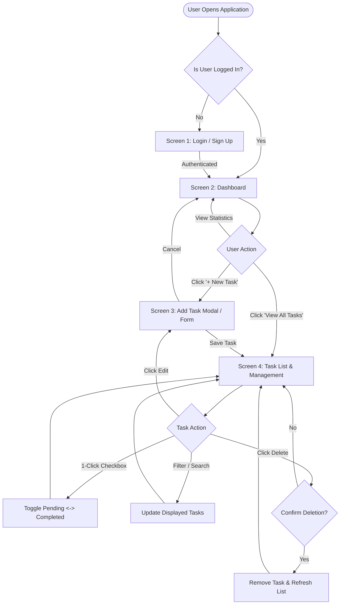
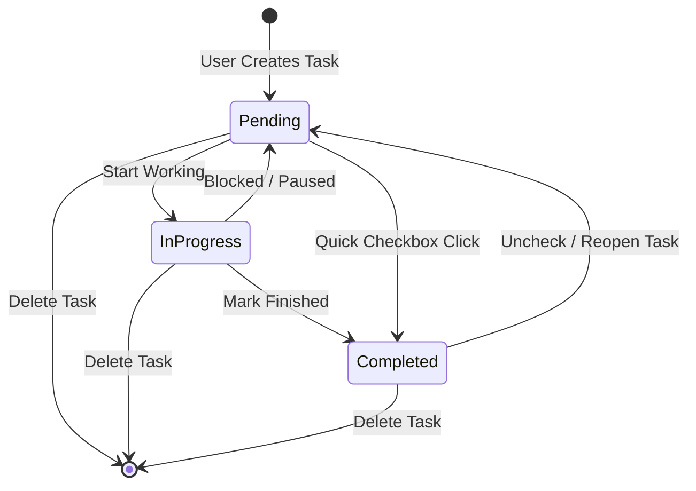
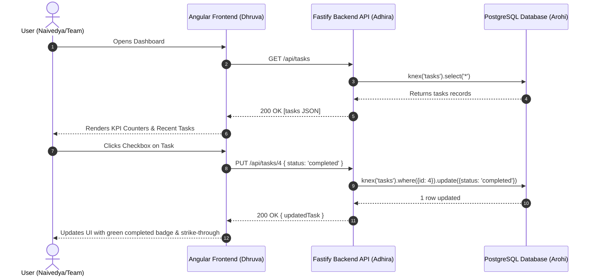

# User Flow & Screen Navigation — Group 4 To-Do Application

**Author:** Naivedya Pramod Yadav ([@Not-naive18](https://github.com/Not-naive18)) — UI/UX Designer  
**Repository:** `arohi06/To-do-project-GRP-4`  
**Git Branch:** `feature/ui-ux`  

---

## 1. High-Level Screen Flow Architecture

---

## 2. Task Lifecycle State Machine

---

## 3. Data Flow Between Frontend and Backend

